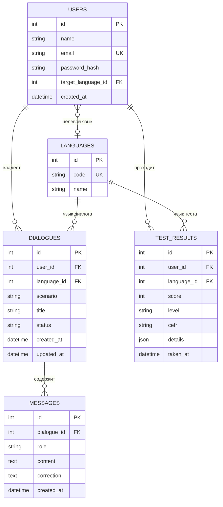

# Схема данных LinguaBot

Документ описывает простую схему данных для базовых сущностей: **пользователь**, **диалог**, **сообщение** и **результат теста**. Схема согласована с модульной структурой backend из `README.md`: модели каждой функции живут внутри своего модуля в `backend/src/linguabot/modules/`.

## ER-диаграмма



## Основные связи

| Связь | Реализация | Смысл |
| --- | --- | --- |
| Пользователь → диалоги | `dialogues.user_id → users.id` | Кому принадлежит диалог |
| Диалог → сообщения | `messages.dialogue_id → dialogues.id` | К какому диалогу относится сообщение |
| Пользователь → результаты тестов | `test_results.user_id → users.id` | Чей результат теста сохраняется |
| Язык → диалоги | `dialogues.language_id → languages.id` | На каком языке идёт диалог |
| Язык → результаты тестов | `test_results.language_id → languages.id` | Для какого языка пройден тест |
| Пользователь → язык | `users.target_language_id → languages.id` | Целевой (изучаемый) язык |

## Сущности и поля

### users — пользователь

Таблица уже реализована в `modules/users/models.py`. Добавляется одно поле и связи.

| Поле | Тип | Ограничения | Описание |
| --- | --- | --- | --- |
| id | int | PK | Идентификатор |
| name | varchar(120) | not null | Имя пользователя |
| email | varchar(255) | unique, index | Логин, уникальный |
| password_hash | varchar(255) | not null | Хеш пароля (bcrypt) |
| target_language_id | int | FK → languages.id, null | Целевой язык обучения |
| created_at | datetime | not null | Дата регистрации |

### languages — язык (справочник)

| Поле | Тип | Ограничения | Описание |
| --- | --- | --- | --- |
| id | int | PK | Идентификатор |
| code | varchar(8) | unique | Код языка: `ru`, `en`, `es` |
| name | varchar(64) | not null | Название: «Русский», «Английский» |

### dialogues — диалог

| Поле | Тип | Ограничения | Описание |
| --- | --- | --- | --- |
| id | int | PK | Идентификатор |
| user_id | int | FK → users.id, index, ON DELETE CASCADE | **Владелец диалога** |
| language_id | int | FK → languages.id, null | Язык диалога |
| scenario | varchar(64) | not null | Slug сценария: `cafe`, `business_meeting` |
| title | varchar(160) | not null | Отображаемое название |
| status | varchar(16) | not null, default `active` | `active` / `completed` |
| created_at | datetime | not null | Начало диалога |
| updated_at | datetime | not null | Последнее изменение |

### messages — сообщение

| Поле | Тип | Ограничения | Описание |
| --- | --- | --- | --- |
| id | int | PK | Идентификатор |
| dialogue_id | int | FK → dialogues.id, index, ON DELETE CASCADE | **Родительский диалог** |
| role | varchar(16) | not null | Автор: `user` / `assistant` |
| content | text | not null | Текст сообщения |
| correction | text | null | Обратная связь / исправленный вариант |
| created_at | datetime | not null | Время сообщения (порядок в диалоге) |

### test_results — результат теста

| Поле | Тип | Ограничения | Описание |
| --- | --- | --- | --- |
| id | int | PK | Идентификатор |
| user_id | int | FK → users.id, index, ON DELETE CASCADE | **Чей результат** |
| language_id | int | FK → languages.id, null | Для какого языка тест |
| score | int | not null | Результат 0–100 |
| level | varchar(24) | not null | `beginner` / `intermediate` / `advanced` |
| cefr | varchar(4) | null | Уровень CEFR: `A1`…`C1` |
| details | json | null | Разбор по вопросам теста |
| taken_at | datetime | not null | Дата прохождения |

## Эскизы моделей SQLAlchemy

Оформлены в стиле существующего кода (`Mapped[]`, `mapped_column`, общий `Base`).

```python
class Language(Base):
    __tablename__ = "languages"

    id: Mapped[int] = mapped_column(primary_key=True)
    code: Mapped[str] = mapped_column(String(8), unique=True, index=True)
    name: Mapped[str] = mapped_column(String(64))


class Dialogue(Base):
    __tablename__ = "dialogues"

    id: Mapped[int] = mapped_column(primary_key=True)
    user_id: Mapped[int] = mapped_column(
        ForeignKey("users.id", ondelete="CASCADE"), index=True
    )
    language_id: Mapped[int | None] = mapped_column(ForeignKey("languages.id"))
    scenario: Mapped[str] = mapped_column(String(64))
    title: Mapped[str] = mapped_column(String(160))
    status: Mapped[str] = mapped_column(String(16), default="active")
    created_at: Mapped[datetime] = mapped_column(
        DateTime(timezone=True), server_default=func.now()
    )
    updated_at: Mapped[datetime] = mapped_column(
        DateTime(timezone=True), server_default=func.now(), onupdate=func.now()
    )

    messages: Mapped[list["Message"]] = relationship(
        back_populates="dialogue", cascade="all, delete-orphan"
    )


class Message(Base):
    __tablename__ = "messages"

    id: Mapped[int] = mapped_column(primary_key=True)
    dialogue_id: Mapped[int] = mapped_column(
        ForeignKey("dialogues.id", ondelete="CASCADE"), index=True
    )
    role: Mapped[str] = mapped_column(String(16))  # user | assistant
    content: Mapped[str] = mapped_column(Text)
    correction: Mapped[str | None] = mapped_column(Text)
    created_at: Mapped[datetime] = mapped_column(
        DateTime(timezone=True), server_default=func.now()
    )

    dialogue: Mapped["Dialogue"] = relationship(back_populates="messages")


class TestResult(Base):
    __tablename__ = "test_results"

    id: Mapped[int] = mapped_column(primary_key=True)
    user_id: Mapped[int] = mapped_column(
        ForeignKey("users.id", ondelete="CASCADE"), index=True
    )
    language_id: Mapped[int | None] = mapped_column(ForeignKey("languages.id"))
    score: Mapped[int] = mapped_column()
    level: Mapped[str] = mapped_column(String(24))
    cefr: Mapped[str | None] = mapped_column(String(4))
    details: Mapped[dict | None] = mapped_column(JSON)
    taken_at: Mapped[datetime] = mapped_column(
        DateTime(timezone=True), server_default=func.now()
    )
```

## Размещение в проекте

| Модель | Файл |
| --- | --- |
| `Language` | `backend/src/linguabot/modules/languages/models.py` |
| `Dialogue`, `Message` | `backend/src/linguabot/modules/dialogues/models.py` |
| `TestResult` | `backend/src/linguabot/modules/assessment/models.py` |
| `User` (дополнение) | `backend/src/linguabot/modules/users/models.py` |

Новые модели нужно импортировать в `init_models()` (`backend/src/linguabot/db/session.py`), чтобы таблицы создавались при старте приложения. При переходе на Alembic те же модели станут основой для миграций.

## Принятые допущения

- **Уровень**: хранится грубый `level` + необязательный `cefr`, поскольку в требованиях упоминаются оба (начальный/средний/продвинутый и Upper-Intermediate).
- **Целевой язык**: один у пользователя (`target_language_id`). Если понадобится несколько изучаемых языков, схема расширяется таблицей `user_languages`.
- **Обратная связь** по сообщению хранится в `messages.correction`. Отдельная таблица `feedback` не вводится, чтобы не усложнять схему.
- На данном этапе описываются 4 сущности и справочник `languages`. Темы, упражнения, планы обучения и прогресс будут отдельными документами.
